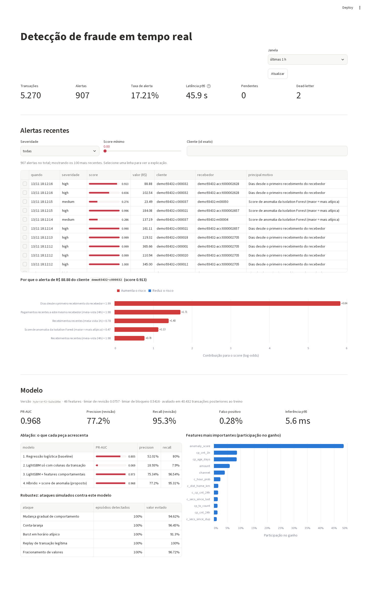
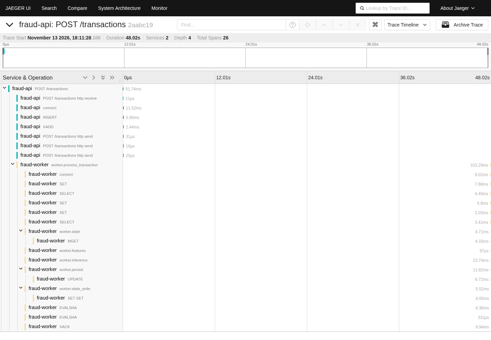
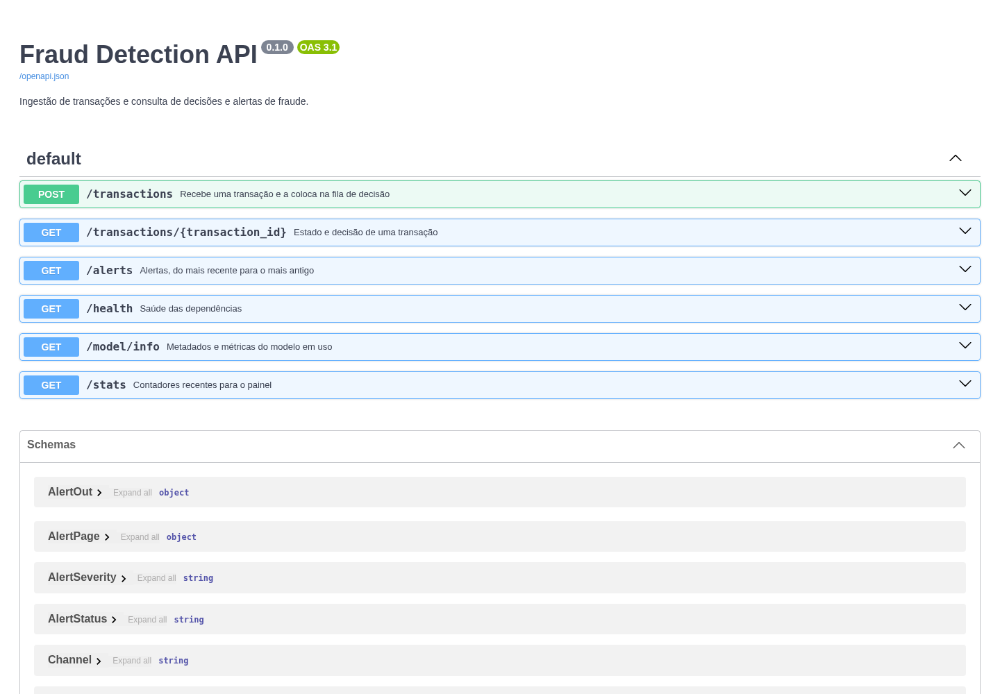
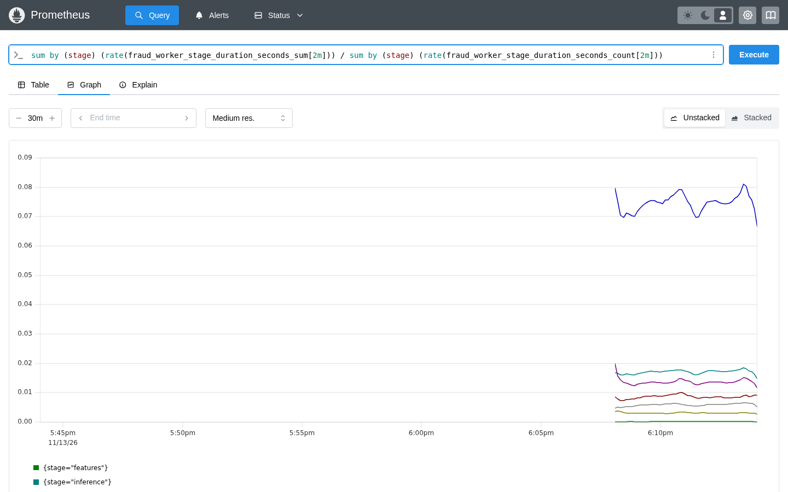

# Detecção de fraude em tempo real

Sistema completo de detecção de fraude em transações financeiras: uma API recebe a
transação, um worker calcula o histórico do cliente e do recebedor em tempo real, um modelo
decide (`approve`, `review` ou `block`) e explica a decisão feature por feature. Em regime,
a decisão sai em **cerca de 15 ms na mediana e menos de 60 ms no p95** depois da entrada na
API (medido em 2 vCPUs).

O projeto inclui um **simulador de ataque que tenta enganar o próprio modelo**, rodando como
suíte de testes. Esse ciclo de atacar, medir e corrigir é a parte mais importante do
trabalho e está em [docs/ADVERSARIAL.md](docs/ADVERSARIAL.md).



## Como rodar

Pré-requisitos: Docker com Compose v2 e `make`. Para os testes, também o
[uv](https://docs.astral.sh/uv/) (`pip install uv`).

```bash
make up      # sobe tudo; na primeira vez constrói a imagem e treina o modelo
make demo    # demonstração de ponta a ponta
make test    # testes unitários, de integração e a suíte adversarial
make down    # para tudo (make clean também apaga os volumes)
```

`make help` lista os demais comandos.

| Serviço | Endereço |
|---|---|
| API (Swagger) | http://localhost:8000/docs |
| Painel | http://localhost:8501 |
| Prometheus | http://localhost:9090 |
| Jaeger | http://localhost:16686 |

**Tempos medidos** em uma máquina de 2 vCPUs e 8 GB (GitHub Codespaces):

| Situação | `make demo` |
|---|---|
| Stack já no ar | 2 min 35 s |
| Do zero, com a imagem já construída (inclui migrações e o treino do modelo, ~1 min) | 3 min 56 s |
| Primeiríssima execução | some o build da imagem, cerca de 3 min, uma única vez |

## O que a demo mostra

`make demo` envia 31 dias de tráfego sintético (21 de aquecimento, para clientes e
recebedores terem histórico) com fraudes "de manual" e os cinco ataques adversariais, espera
o worker decidir tudo e compara as decisões com o gabarito do simulador:

```text
== Saúde do sistema ==
  {'status': 'ok', 'checks': {'database': 'ok', 'redis': 'ok', 'model': 'ok'}}
  modelo hybrid-f2-5a3e189e: PR-AUC 0.968 no teste offline, 46 features

== Contrato da API ==
  valor negativo -> HTTP 422: {"error": {"code": "validation_error", "message": "Requisição inválida", "details": [{"f ...
  mesma Idempotency-Key duas vezes -> HTTP 202, depois HTTP 200; mesmo id: True

== Enviando 2595 transações (31 dias simulados, sendo 21 de aquecimento; 183 fraudulentas) ==

  aceitas: 2595/2595

== Aguardando o worker decidir ==

== Decisões do modelo contra o gabarito do simulador (após o aquecimento) ==
  transações: 976   fraudes: 168   alertas: 176
  precision: 89.8%   recall: 94.0%   falso positivo: 2.23%

  cenário                              transações  recall tx   episódios detectados
  Tomada de conta                               4       100%                    1/1
  Mudança gradual de comportamento             19        89%                    2/2
  Conta-laranja                                64        97%                    2/2
  Burst em horário atípico                     23        83%                    2/2
  Replay de transação legítima                 12        92%                    2/2
  Cartão roubado (e-commerce)                   6       100%                    1/1
  Fracionamento de valores                     40        98%                    2/2

== Latência sob rajada (carga em lote: inclui o tempo de espera na fila) ==
  p50 20.1 s   p95 45.6 s   (2595 transações enviadas de uma vez)

== Alertas com explicação (GET /alerts) ==
  272 alertas de severidade alta no total; três desta execução:

  cliente demo93277-c000021  R$ 184.08  score 0.996  gabarito: Mudança gradual de comportamento
    +4.83  Score de anomalia da Isolation Forest (maior = mais atípica) = 0.57
    +3.60  Dias desde o primeiro recebimento do recebedor = 9.02
    +1.65  Pagamentos recentes a este mesmo recebedor (meia-vida 24h) = 2.10

  cliente demo93277-c000032  R$ 88.88  score 0.911  gabarito: Mudança gradual de comportamento
    +5.84  Dias desde o primeiro recebimento do recebedor = 1.99
    +1.70  Pagamentos recentes a este mesmo recebedor (meia-vida 24h) = 1.98
    +1.39  Recebimentos recentes (meia-vida 1h) = 0.78

  cliente demo93277-c000032  R$ 102.54  score 0.640  gabarito: Mudança gradual de comportamento
    +5.47  Dias desde o primeiro recebimento do recebedor = 1.98
    +1.88  Recebimentos recentes (meia-vida 1h) = 0.00
    +0.96  Pagamentos recentes a este mesmo recebedor (meia-vida 24h) = 1.00

== Latência em regime (fila vazia, uma transação por vez) ==
  entrada na API -> decisão gravada: p50 15 ms   p95 59 ms   p99 84 ms   (n=39)

== Tratamento de falhas: dead-letter queue ==
  mensagem envenenada publicada na fila -> DLQ foi de 0 para 1; o worker seguiu processando

== Pronto em 112 s ==
  Painel      http://localhost:8501
  API (docs)  http://localhost:8000/docs
  Prometheus  http://localhost:9090
  Jaeger      http://localhost:16686  (serviço fraud-api: um trace cobre API -> fila -> worker)

real	3m55.756s
user	0m0.721s
sys	0m0.312s
```

Como ler esses números:

- **Latência em regime** é a que importa para o caso de uso: fila vazia, uma transação por
  vez. A "latência sob rajada" é o tempo de fila quando milhares de transações chegam de uma
  vez; ela mede a vazão do worker (cerca de 55 transações por segundo com duas réplicas em 2
  vCPUs), não o tempo de decisão.
- **Latência em regime varia entre execuções** (p95 entre 33 e 59 ms nas que medi): são
  cerca de 40 amostras em uma máquina compartilhada.
- **O falso positivo da demo é maior que o do relatório do modelo** (0,28% no teste offline,
  0,41% na bateria adversarial com 65 mil transações). A demo tem poucas dezenas de clientes
  e três semanas de histórico; uma única vaquinha legítima recebendo de muita gente já move
  o número. Vaquinhas são, de fato, o ponto fraco conhecido do modelo (seção de limitações).
- **A taxa de alerta no painel logo após a demo é alta** (acima de 10%): a janela inclui os 21
  dias de aquecimento, em que o sistema parte do zero, e as fraudes são 7% do tráfego da demo.
- A demo varia um pouco entre execuções: com dois workers, a ordem de chegada não é
  determinística.

## Arquitetura em um parágrafo

`POST /transactions` valida, grava no PostgreSQL como `pending`, publica o id em um Redis
Stream e responde `202`. Um worker em consumer group lê a mensagem, pega locks nas duas
entidades, carrega o estado do cliente e do recebedor do Redis (ou reconstrói do PostgreSQL
se o cache sumiu), calcula as features com **a mesma função usada no treino**, roda o modelo,
grava decisão, explicação e alerta em uma transação de banco e confirma a mensagem. Falhas
passam por retry com backoff, dead-letter queue, reentrega de mensagens órfãs e um sweeper.

Diagrama, fluxo passo a passo, modelo de dados e concorrência em
[docs/ARCHITECTURE.md](docs/ARCHITECTURE.md).

Um único trace cobre a transação da API até o worker, atravessando a fila:



## O modelo

LightGBM sobre 45 features (7 da própria transação e 38 de comportamento: histórico do
cliente e do recebedor mantido em streaming, com custo constante por transação), mais o score de uma Isolation Forest como
feature adicional, calibração de probabilidade e limiares definidos por orçamento de alertas.
Cada decisão vem com as contribuições TreeSHAP.

Resultado no bloco de teste (40 mil transações posteriores ao treino no tempo):

| Modelo | PR-AUC | Precision | Recall |
|---|---:|---:|---:|
| 1. Regressão logística (baseline) | 0,805 | 52,0% | 80,0% |
| 2. LightGBM só com as colunas da transação | 0,069 | 18,9% | 7,9% |
| 3. LightGBM + features comportamentais | 0,973 | 75,3% | 96,5% |
| 4. Híbrido: + score de anomalia (servido) | 0,968 | 77,2% | 95,3% |

Precision e recall no limiar de revisão (orçamento de 0,3% de falso positivo). Relatório
completo, gerado pelo treino, em [docs/MODEL_REPORT.md](docs/MODEL_REPORT.md).

Três coisas que essa tabela diz, e que eu defenderia em uma entrevista:

1. **O salto vem das features de estado, não do algoritmo.** O mesmo LightGBM sem histórico
   (linha 2) perde até para uma regressão logística com histórico.
2. **O score de anomalia não mostrou ganho.** As linhas 3 e 4 são estatisticamente
   indistinguíveis, e os testes adicionais (ataques nunca vistos, dados reais) deram
   resultado misto. A hipótese da fase de pesquisa não se confirmou, e isso está registrado
   com os números no [ADR 006](docs/decisions/006-modelo-hibrido.md).
3. **Os dados são sintéticos**, então os valores absolutos não se transferem para produção.
   No dataset real da ULB, que não tem cliente nem recebedor e portanto não permite as
   features de comportamento, o mesmo código de treino chega a PR-AUC de 0,74 a 0,77
   ([docs/BENCHMARK_KAGGLE.md](docs/BENCHMARK_KAGGLE.md)).

## Auto-verificação adversarial

Cinco ataques desenhados para passar pelo modelo: usam o aparelho da vítima, a localização
habitual e valores normais. Detecção por episódio na bateria padrão (outra população, outras
sementes, 60 episódios por ataque):

| Ataque | v1 (features clássicas) | + features v2 | + treino adversarial (final) | Ataque nunca visto no treino |
|---|---:|---:|---:|---:|
| Fracionamento de valores | 40% | 85% | **100%** | 100% |
| Mudança gradual de comportamento | 12% | 5% | **100%** | 63% |
| Burst em horário atípico | 95% | 98% | **100%** | 97% |
| Conta-laranja | 68% | 100% | **100%** | 100% |
| Replay de transação legítima | 17% | 40% | **100%** | 80% |
| Falso positivo em legítimas | 0,31% | 0,19% | 0,41% | 0,42% |

**Alvo, definido antes de medir o modelo final:** em cada ataque, pelo menos 90% dos
episódios detectados e 70% do valor evitado, com falso positivo de até 0,5%. O modelo final
atinge o alvo nos cinco ataques, inclusive em versões mais discretas que as do treino.

A última coluna é o controle que impede a leitura otimista: cada ataque é avaliado por um
modelo treinado **sem** ele. Três de cinco atingem o alvo; mudança gradual e replay inéditos,
não. É o risco residual declarado do sistema.

O documento completo conta também as quatro vezes em que o resultado estava bom demais
porque o modelo tinha aprendido um defeito do simulador, e como as explicações por feature
revelaram cada uma: [docs/ADVERSARIAL.md](docs/ADVERSARIAL.md).

## API

| Método | Rota | O que faz |
|---|---|---|
| `POST` | `/transactions` | Recebe uma transação e a enfileira. `202` com o id. Aceita `Idempotency-Key`. |
| `GET` | `/transactions/{id}` | Estado, score, decisão e explicação. |
| `GET` | `/alerts` | Alertas com paginação (`limit`, `offset`) e filtros (`severity`, `status`, `customer_id`, `min_score`, `since`, `until`). |
| `GET` | `/health` | Saúde de banco, Redis e modelo. `503` se banco ou Redis estiverem fora. |
| `GET` | `/model/info`, `/stats`, `/metrics` | Metadados do modelo, contadores para o painel, métricas Prometheus. |

```bash
curl -s -X POST localhost:8000/transactions \
  -H 'content-type: application/json' -H 'Idempotency-Key: exemplo-1' \
  -d '{"customer_id": "c1", "counterparty_id": "loja-9", "amount": "129.90",
       "channel": "ecommerce", "category": "electronics", "device_id": "d1",
       "latitude": -23.55, "longitude": -46.63}'
```

Todo erro usa o mesmo envelope:

```json
{"error": {"code": "validation_error", "message": "Requisição inválida",
           "details": [{"field": "body.amount", "message": "Input should be greater than 0",
                        "type": "greater_than"}],
           "request_id": "fceab16f879d402697c1a21cf0347e38"}}
```



## Testes

`make test` roda as três suítes, 119 testes em cerca de 2 minutos (sobe PostgreSQL e Redis via
Compose):

| Suíte | O que cobre |
|---|---|
| `tests/unit` | Features (decaimento, sem vazamento, cada família v2), paridade treino e serviço, modelo, métricas, drift, simuladores, schemas, painel |
| `tests/integration` | API e worker contra PostgreSQL e Redis reais: idempotência, retry, dead-letter, reentrega de mensagem órfã, sweeper, perda do cache, dois workers concorrentes, migrações em dia com os modelos |
| `tests/adversarial` | Os cinco ataques contra o modelo treinado com a configuração padrão, um teste por ataque |

O CI (GitHub Actions) roda lint, mypy estrito, as três suítes e o build da imagem.

## Observabilidade

- **Logs** em JSON (structlog), com `request_id`, `trace_id` e `span_id` em cada linha.
- **Métricas** Prometheus na API (`/metrics`) e em cada worker (`:9100`): latência de
  decisão, duração por etapa do worker, lag da fila, retries e dead-letters, taxa de alerta,
  hit e miss do cache de estado e PSI dos scores (drift sem rótulo).
- **Tracing** OpenTelemetry exportado para o Jaeger; o contexto viaja dentro da mensagem da
  fila.



## Estrutura

```
src/fraud/
  api/            FastAPI: rotas, schemas Pydantic, erros padronizados
  worker/         consumo do stream, processamento de uma transação, tratamento de falhas
  features/       estado incremental e cálculo de features (única implementação)
  ml/             treino, avaliação, modelo, inferência, drift, relatórios, avaliação adversarial
  simulation/     mundo sintético, ataques, gerador de tráfego, demo
  db/             modelos SQLAlchemy          observability/  logs, métricas, tracing
  dashboard/      painel Streamlit
alembic/          migrações
tests/            unit, integration, adversarial
docs/             pesquisa, arquitetura, decisões, relatórios
```

## Documentação

| Documento | Conteúdo |
|---|---|
| [RESEARCH.md](docs/RESEARCH.md) | Fase A: literatura e prática sobre desbalanceamento, features, drift e latência; proposta de modelo; referências |
| [ARCHITECTURE.md](docs/ARCHITECTURE.md) | Fase B: diagrama, componentes, fluxo de uma transação, modelo de dados, concorrência |
| [decisions/](docs/decisions/README.md) | 12 ADRs: cada decisão com contexto, alternativas descartadas e consequências |
| [FEATURES.md](docs/FEATURES.md) | Todas as features, o que medem e em que versão entraram (gerado do código) |
| [MODEL_REPORT.md](docs/MODEL_REPORT.md) | Métricas, ablação, importância, latência (gerado pelo treino) |
| [ADVERSARIAL.md](docs/ADVERSARIAL.md) | Fase D: ataques, alvo, ciclo de melhoria, atalhos do simulador, risco residual |
| [BENCHMARK_KAGGLE.md](docs/BENCHMARK_KAGGLE.md) | O mesmo código de treino no dataset real da ULB |
| [KNOWN_ISSUES.md](docs/KNOWN_ISSUES.md) | Revisão crítica: dívidas técnicas, riscos de produção e o que falta para escalar |
| [INTERVIEW.md](docs/INTERVIEW.md) | Resumo em dois minutos, 25 perguntas com resposta e os trade-offs de cada decisão |
| [STUDY_PATH.md](docs/STUDY_PATH.md) | Ordem de leitura do código, com conceito e pergunta de verificação por passo |
| [EXTENSIONS.md](docs/EXTENSIONS.md) | Cinco extensões, da mais fácil à mais difícil |

## Limitações conhecidas

Resumo abaixo; a revisão completa, com correção sugerida e esforço de cada item, está em
[docs/KNOWN_ISSUES.md](docs/KNOWN_ISSUES.md).

- **Dados sintéticos.** O simulador é meu, os ataques são meus. Vale o método e as
  comparações relativas, não os números absolutos.
- **Vaquinhas legítimas são sinalizadas com frequência** (metade das transferências para
  elas no teste): uma conta
  nova recebendo de muita gente é, para o modelo, uma conta-laranja. Separar as duas exige
  sinal que o simulador não tem (cadastro do recebedor, por exemplo).
- **Partida a frio do sistema inteiro.** O modelo foi treinado com semanas de histórico. Num
  sistema recém-ligado todo recebedor parece novo e o falso positivo dispara; o PSI dos
  scores acusa isso imediatamente, e por isso a demo tem período de aquecimento.
- **Decisão assíncrona.** Para autorização de cartão a decisão teria de ser síncrona
  ([ADR 002](docs/decisions/002-decisao-assincrona-com-redis-streams.md)).
- **Rótulos instantâneos.** O atraso real de rótulos (chargeback em semanas) está descrito na
  pesquisa e não simulado. Não há retreino automático nem feedback de analista.
- **Sem autenticação** na API, sem alta disponibilidade de Redis e PostgreSQL, sem comando
  para reprocessar a dead-letter queue.
- **Fuso horário.** A hora do dia é calculada em UTC; em produção seria a hora local do
  cliente.

## Dados

O dataset real (`data/creditcard.csv`, [ULB/Kaggle](https://www.kaggle.com/datasets/mlg-ulb/creditcardfraud))
não está no repositório e só é necessário para `make benchmark`. Todo o resto usa dados
gerados pelo simulador, com sementes fixas.
